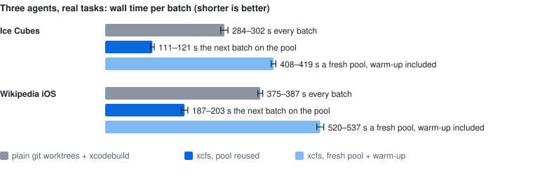
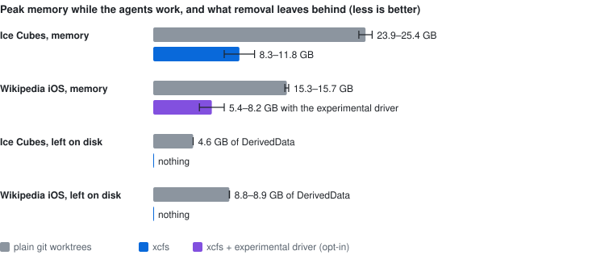
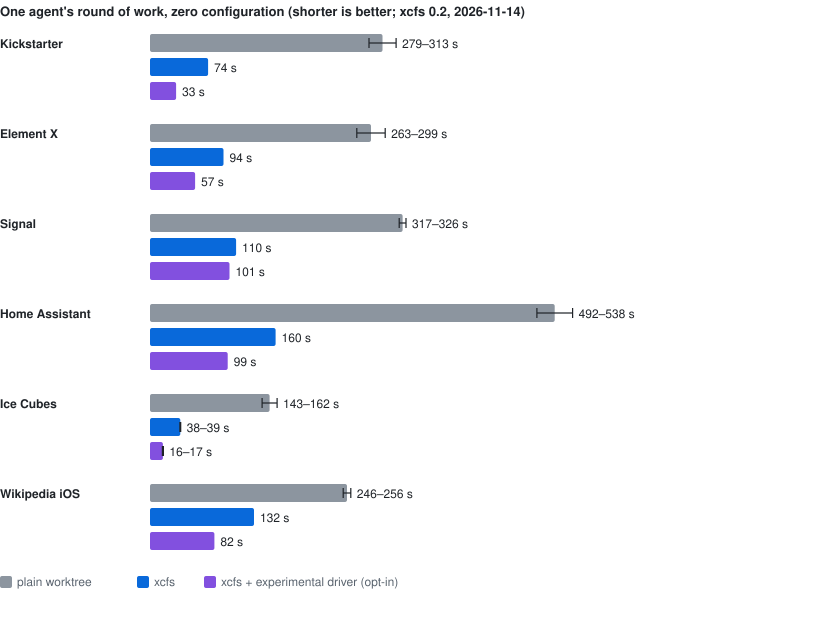

# xcfs

**A file-system layer for agentic iOS development: several AI agents, each in its own git worktree of one Xcode
project, building features in parallel — without a cold build per worktree, without filling the disk, and without
stepping on each other.**

Each agent gets a checkout that is already built (a slot of a pool kept at the baseline), an incremental build session,
a one-file compile check, its own simulator, and a cleanup that removes everything the checkout made and nothing else.
It plugs into Claude Code's worktree and session hooks, so `claude --worktree` and subagents with worktree isolation
get xcfs checkouts with no change in how anyone works.

`xcfs` is the tool's name, not a kernel file system: git worktrees, APFS clones and Xcode's own build service; no root,
no kernel extension, Xcode unmodified. **v0.2.0**, Python 3 standard library only (3.9 or later), MIT;
[docs/design.md](docs/design.md) says what is measured, what is planned and what is not verified.

## The problems it solves

Measured on public apps, three agents at once unless noted, on one machine: **MacBook Pro, Apple M1 Max (10 cores),
64 GB, macOS 27.2, Xcode 27.2** ([docs/benchmark.md](docs/benchmark.md), raw results in
[bench/results](bench/results/README.md)). Other machines will differ; slower disks and less memory change the numbers.

| when several agents each get a worktree | plain `git worktree` + `xcodebuild` | xcfs |
|---|---|---|
| every new worktree builds from nothing | every batch waits for cold builds: 284–302 s on Ice Cubes, 375–387 s on Wikipedia | slots stay built; the next batch on a pool: 111–121 s, 187–203 s |
| DerivedData outlives the worktree | 1.5 GB per worktree left in the global DerivedData (Ice Cubes), 2.9 GB (Wikipedia) | build output lives with the checkout and goes with it: nothing left |
| memory | 24–25 GB, 15–16 GB at the peak | 8–12 GB, 5–8 GB |
| agents test on the simulator they all name | a test run killed by another agent's: 1 of 6 runs (Ice Cubes), 2 of 6 (Wikipedia) | one simulator per checkout: none |
| dependencies resolved and fetched again for every worktree | each worktree resolves its packages, installs its pods | the dependency layer is cloned in (APFS clonefile, blocks shared) |
| `xcodebuild`'s fixed cost on every build | a no-op build: 5.9 s (Ice Cubes, one agent) | a persistent build session: 0.9 s; `xcfs check` compiles one file in 1–4 s |
| a public declaration in a widely imported module recompiles everything that imports it | 25 s (Ice Cubes), 35 s (Wikipedia) | 6 s, 15 s with the optional experimental Swift driver |
| cleanup scripts guess by path or age | `rm -rf` and hope | a registry: nothing with unsaved work, nothing xcfs did not create, is deleted |

## Benchmarks

All charts: MacBook Pro, Apple M1 Max (10 cores), 64 GB, macOS 27.2, Xcode 27.2, building for one architecture.

<picture>
  <source media="(prefers-color-scheme: dark)" srcset="docs/img/agents-wall-time-dark.svg">
  
</picture>

Three agents start at once, each with a task defined in advance: add a function, get a compile error, fix it, add a
unit test, run it, build the app. The pool pays its warm-up once (three slots: 280–301 s on Ice Cubes, 278–279 s on
Wikipedia), so the first batch on a fresh pool is slower than plain worktrees; every later batch is 1.8–2.7× faster.
MacBook Pro, M1 Max, 64 GB, macOS 27.2, Xcode 27.2, one architecture; whiskers are the range over two runs.
[Tables and method](docs/benchmark.md#three-agents-real-tasks-at-the-same-time).

<picture>
  <source media="(prefers-color-scheme: dark)" srcset="docs/img/agents-memory-disk-dark.svg">
  
</picture>

The same runs. xcfs's warm-up itself peaks at 21–25 GB (Ice Cubes) and 10 GB (Wikipedia) while it builds three slots
side by side; `warmJobs` builds fewer at once (a smaller machine; not measured on one).

<picture>
  <source media="(prefers-color-scheme: dark)" srcset="docs/img/zero-config-round-dark.svg">
  
</picture>

Six public apps, four of them never built while xcfs was developed, each with a config that only names the project, the
scheme and the destination. One agent's round: checkout, build, five edits each checked, a final build, cleanup. Plain:
three runs each; xcfs: the run after the fixes those apps led to (two on Ice Cubes). 3–10× less time, no build
failed, and plain worktrees left 1.5–6 GB behind each, xcfs nothing.
[Table](docs/benchmark.md#zero-configuration-on-projects-xcfs-was-not-developed-on).

A pool at rest (three Ice Cubes slots): 2.3 GB resident and no CPU while idle; after 30 minutes without a build each
slot's session quits and nothing stays resident (`sessionIdleMinutes`); 6.0 GB on disk for the three.
[Details](docs/benchmark.md#a-pool-at-rest). The charts are drawn from the raw results by `scripts/charts.py`.

## Use it with an AI agent

**Claude Code.** Two hooks hand every worktree Claude Code creates — `claude --worktree <name>` (`claude -w`), a
subagent with `isolation: "worktree"`, the `EnterWorktree` tool, a background session — to xcfs: a built slot when
the pool has a free one, else a new xcfs worktree, on `worktree-<name>`, recorded under the session. A session-end hook
returns everything the session opened. One command installs the three:

```
xcfs hook install            # shows what it would add to ~/.claude/settings.json (every project)
xcfs hook install --apply    # writes it; hooks that are not xcfs's are kept
xcfs hook install ~/src/app --apply   # or into one repository's .claude/settings.json
```

It refuses when another tool's worktree hook is installed, `xcfs hook uninstall --apply` takes them out again, and
`xcfs hook status` shows what is there. What it writes
([examples/agent-hooks/claude-code-settings.json](examples/agent-hooks/claude-code-settings.json)):

```json
{
  "hooks": {
    "WorktreeCreate": [{ "hooks": [{ "type": "command", "command": "xcfs hook worktree-create" }] }],
    "WorktreeRemove": [{ "hooks": [{ "type": "command", "command": "xcfs hook worktree-remove" }] }],
    "SessionEnd": [{ "hooks": [{ "type": "command", "command": "xcfs hook session-end" }] }]
  }
}
```

Removal refuses when a worktree holds uncommitted work, and the agent tool then keeps it; commits stay on their
branches, and with `--prune-branch` a branch xcfs created that never got a commit is deleted. Claude Code does not run the remove hook for a subagent's worktree: the session-end hook (or
`xcfs reap --older-than 3`) returns those.

**Other agent tools** call the same commands, with `--json` for machine-readable results:

```
xcfs checkout <repo> <branch> --session "$SESSION" --json    # a built slot; prints its path
xcfs build --json / xcfs check <files> --json / xcfs test --json
xcfs release --prune-branch --json                           # done with the task
xcfs reap --session "$SESSION" --apply --prune-branch --json # the session ends
```

`reap` lists what it left (uncommitted work) under `left` and exits 0, so a hook does not fail. Or call the hook
commands themselves (`xcfs hook worktree-create` reads `{"name", "cwd", "session_id"}` on stdin and prints
the path; `xcfs hook session-end` reads `{"session_id"}` and runs that `reap`). For people and tools used to `git worktree add`, a shell function keeps the habit:
`xwt() { cd "$(xcfs checkout "$(git rev-parse --show-toplevel)" "$1" --json | jq -r .worktree)"; }`.
[docs/agents.md](docs/agents.md) has the contract (steps, fields, exit codes), and
[examples/agent-instructions](examples/agent-instructions/README.md) a block for any tool's instruction file (`AGENTS.md`,
`GEMINI.md`, …).

## Quick start

```
brew install PatrickSCLin/xcfs/xcfs
xcfs init ~/src/app --user                       # detect the project, scheme, platform; save a config for you only
xcfs doctor ~/src/app                            # check the machine and the project
xcfs pool warm ~/src/app --slots 3 --background  # build three slots at the baseline
xcfs checkout ~/src/app feature/x                # a built slot for this branch; prints its path
```

Then `xcfs build`, `xcfs check <file>`, `xcfs test`, `xcfs run` inside it, `xcfs release` when done — or install the
hooks above and let the agent tool do it.

## When it does not help much

- **One checkout, day to day.** Without parallel checkouts there is no pool to reuse; what remains is the build
  session (a no-op build 5.9 → 0.9 s, a small edit 8 → 3–4 s on Ice Cubes), `xcfs check`, and `xcfs session start`
  when the project is opened, so that the first build does not wait for the session and the project description.
- **The first batch on a fresh pool**, as above: the warm-up costs more than plain worktrees' cold builds, and
  skipping it is slower still (451 s against 284–302 s on Ice Cubes, one run): warm the pool before the agents need it.
- **CI.** Fresh machines and one build per job: no pool survives between jobs, and remote build caches are out of
  scope ([docs/build-systems.md](docs/build-systems.md)).
- **Bazel projects:** incremental builds are Bazel's own; xcfs helps with the wait for a checkout and with cleanup.

## Requirements

- macOS on APFS, git, `python3` 3.9 or later (the one in the Xcode command-line tools works); measured on Apple
  silicon.
- Xcode for the Xcode adapter; the persistent build session uses the `swbuild` tool inside Xcode
  ([Build session](#build-session)).
- A repository, its worktrees and its pool on one APFS volume; `xcfs` refuses rather than silently copying in full.
- Optional: the experimental Swift driver applies to Xcode 27.x (Swift 6.4) only; elsewhere builds use Xcode's own
  driver. [docs/xcode-versions.md](docs/xcode-versions.md) lists what was run on which Xcode version and what happens
  on one that does not fit.

## Correctness

- **Incremental equals clean**, checked on real apps with `bench/oracle.py`: after each of a series of edits (a stored
  property added to an `@Observable` class, an enum case that breaks callers, `@objc` changes across Swift and
  Objective-C, …) every object file of the incremental build is compared with a clean build of the same sources: no
  difference on Ice Cubes (9 steps, Xcode 27.2 and 27.1) or Wikipedia (6 steps)
  ([details](docs/benchmark.md#is-an-incremental-build-the-same-as-a-clean-one)).
- **The experimental driver is self-tested** before it is used (19 edits and undos, byte for byte against clean builds,
  and a check that it narrows rebuilds at all); a driver that fails, a release it does not fit, or a tag that moved,
  means Xcode's own driver ([its notes](lib/xcfs/adapters/swiftdriver/README.md)).
- **The build session is checked** once per Xcode version before it is used, and builds fall back to `xcodebuild` when
  the check fails.
- **Nothing is deleted without `--apply`**, nothing that holds unsaved work, nothing xcfs did not create.

## Install

From the source instead of Homebrew:

```
git clone https://github.com/PatrickSCLin/xcfs ~/src/xcfs
ln -s ~/src/xcfs/bin/xcfs ~/.local/bin/xcfs     # any directory on PATH
xcfs --version
```

`brew install --HEAD PatrickSCLin/xcfs/xcfs` installs `main`. `bin/xcfs` finds its code in `../lib` (or `../libexec`).
To install one file instead (a dotfiles manager, a package manager), build it: `scripts/build-single-file.sh` writes
`dist/xcfs`, the whole tool as a Python zip application. A release: tag it (`vX.Y.Z`, matching `lib/xcfs/__init__.py`),
then `scripts/homebrew-formula.sh X.Y.Z` fills the formula's url and sha256 from the tarball GitHub serves for the tag;
copy it into the tap as `Formula/xcfs.rb`.

What runs on its own: on the first build with an Xcode of the Swift 6.4 line, xcfs builds a patched
[swift-driver](https://github.com/swiftlang/swift-driver) in the background (`git clone` of the release tag — for the
releases the patch was made on, only if the tag points at the known commit; `git apply`; `swift build`; a correctness
self-test; one to two minutes, about 400 MB in `~/Library/Caches/xcfs/swift-driver`, plus the per-module digests it
keeps there), and uses it for Swift compilation once the self-test has passed. Until then, and whenever anything does
not fit, builds use Xcode's own driver. `"swiftDriver": "native"` in a configuration (or `XCFS_SWIFT_DRIVER=native`)
turns it off; `xcfs doctor` shows its state.

**Removing it.** `xcfs uninstall` lists everything xcfs made on the machine — its worktrees, pools, build output,
dependency snapshots, the experimental driver's cache, simulators, its hooks in Claude Code's settings and its state —
and `xcfs uninstall --apply` removes it. A worktree or slot that holds unsaved work is kept (exit 5; save the work and
run it again); your configs stay. Then `brew uninstall xcfs`.

## How it works

| problem | how |
|---|---|
| dependency layer | cloned with APFS clonefile (shares blocks), from a snapshot that matches the lock files |
| cold builds | a **pool** of slots at fixed paths, kept built at the baseline; handing one out costs only the difference |
| fixed overhead | a **persistent build session** that keeps the build service and the build description alive |
| build output | outside the source tree, one directory per checkout and configuration, removed with the checkout |
| simulators | one per checkout, created and first booted during the slot's warm-up, deleted with the checkout |
| cleanup | a registry of what xcfs created; nothing is deleted that holds unsaved work or is not provably its own |

**The experimental Swift driver.** On Xcode 27.x (Swift 6.4), xcfs builds a patched swift-driver in the background
and uses it once it passes its self-test: after a public declaration is added to a widely imported module, it
recompiles only the files that use what changed (Ice Cubes 25 → 6 s, Wikipedia 35 → 15 s). It is on by default where it
applies and off everywhere else. In the three-agent tasks it made the next batches faster (111–121 vs 138–151 s) and
the fresh pool's warm-up slower (408–419 vs 354–376 s, warm-up included). See
[its notes](lib/xcfs/adapters/swiftdriver/README.md) and [docs/incremental-swift.md](docs/incremental-swift.md).

Measured on a large app (≈1,800 targets) with prototypes of the same mechanisms: a no-op build 34–36 s → ≈4 s, a
function-body edit 37–39 s → 6–7 s, the first build of a new checkout ≈285 s → 4–50 s from an up-to-date slot. On the
small [sample](examples/generic-sample): cold build 9 s, no-op 0.15 s, an edit 0.9 s, a single-file check 0.5 s
through the session; a slot handed out in 0.3 s whose first build takes 1.2 s.

## Commands

| command | what it does |
|---|---|
| **worktrees** | |
| `xcfs new <repo> <branch> [dest] [--from REF] [--session ID]` | A worktree of the repository set (and the branch, if it does not exist), with the dependency layer cloned in, carried files copied, `afterSeed` commands run. Fails without leaving anything behind. |
| `xcfs rm <worktree> [--apply] [--discard-ignored] [--prune-branch]` | Remove a worktree with its build output, global DerivedData and simulator. Refuses if anything would be lost. |
| `xcfs reap (--session ID \| --older-than DAYS \| --all) [--apply] [--prune-branch]` | Remove the clean worktrees and return the clean slots of a session (or of that age); report the rest. |
| `xcfs adopt <worktree> [--session ID \| --release]` | Hand a worktree to a session, take a plain `git worktree add` under management, or exempt one from `reap`. |
| `xcfs ls [--session ID] [--status] [--sizes]` | The worktrees xcfs manages. |
| **pool** | |
| `xcfs checkout <repo> <branch> [--from REF] [--session ID] [--wait S] [--build]` | Lease the best free slot (built at the current baseline with the current toolchain first; a new one if the pool is not full), switch it to the branch, print its path. Exit 10 when every slot is taken. |
| `xcfs release [path] [--prune-branch] [--discard-ignored] [--no-warm]` | Return the slot: refuses if anything would be lost, goes back to the baseline, rebuilds there in the background. |
| `xcfs pool status [repo] [--watch]` | Slots, their state, leases (stale ones flagged), whether they are built at the current baseline; for a warm-up under way, its step, how long it has run and how long the last one took. `--watch` repeats it until no slot is being created or warmed. |
| `xcfs pool warm <repo> [--slots N] [--slot PATH] [--clean] [--fetch] [--background]` | Create missing slots; bring idle ones to the baseline and build them. |
| `xcfs pool resize <repo> N` | Change the number of slots; idle extras are retired now, leased ones when returned. |
| **building** (in a worktree, a slot, or any checkout) | |
| `xcfs build [path] [--config NAME] [--toolchain NAME] [--timeout S]` | Incremental build. |
| `xcfs check <file>... [--config NAME]` | Compile-check these files (see [Build session](#build-session) for what a pass means). |
| `xcfs test [path] [--config NAME] [--scheme NAME] [--only TARGET/CLASS[/METHOD]]...` | Run tests on the checkout's own simulator; `--scheme` names another scheme (a package's tests). With the session driver the session builds the tests (only what changed since the last build) and xcodebuild runs them without building. |
| `xcfs run [path] [--config NAME]` | Build, install on the checkout's simulator, launch. |
| `xcfs session start [path] [--config NAME]` | Start the checkout's build session with its project description exported, building nothing, so the next build starts at once (a shell hook or an editor task can run it when a project is opened). With the `xcodebuild` driver it does nothing. |
| **agent tools** | |
| `xcfs hook worktree-create \| worktree-remove` | For a tool's own worktree hooks (Claude Code's `WorktreeCreate`/`WorktreeRemove`): JSON on stdin; create prints the path of a built slot or a new xcfs worktree. See [docs/agents.md](docs/agents.md#worktrees-an-agent-tool-creates-by-itself). |
| `xcfs hook session-end` | For a tool's session-end hook (Claude Code's `SessionEnd`): JSON with `session_id` on stdin; removes the session's clean worktrees and returns its clean slots (`reap --session ID --apply --prune-branch`), records what was left in `last-reap.json` in the state directory, and always exits 0. |
| `xcfs hook install \| uninstall \| status [repo] [--apply]` | Put the three hooks in Claude Code's settings — the user's, or `<repo>/.claude/settings.json` — or take them out. Shows the changes; writes only with `--apply`; keeps every hook that is not xcfs's; refuses when another tool's worktree hook is installed. |
| **maintenance** | |
| `xcfs gc [--apply] [--foreign] [--sizes] [--stale-days N]` | Repair interrupted operations, return clean slots whose lease went stale, drop unused dependency snapshots and the build output of vanished checkouts. `--foreign` also reports (with `--apply`, removes) orphaned or stale global DerivedData xcfs did not create. `--sizes` shows what xcfs holds on disk — each pool, its caches, its worktrees — against the free space (clones share blocks, so these are upper bounds). |
| `xcfs doctor [path] [--session-check]` | Environment, hygiene and toolchain checks, and for a checkout xcfs built its build session, project description and simulator; `--session-check` runs the build-session regression check. |
| `xcfs init [repo] [--write \| --user] [--force]` | Detect what the repository needs and suggest a config: the project or workspace, the scheme (the one named after it, else one that builds an app), the platform and a configuration for it, git-ignored settings files to carry, dependency directories to seed and the lock files that key them; an XcodeGen or Tuist project's generated project and workspace are seeded too (or, when not generated yet, it says what to run). Prints what it found and the next commands. `--write` saves `.xcfs.json` in the repository, `--user` saves `~/.config/xcfs/<repo>.json` and leaves the repository untouched; an existing config is never overwritten without `--force`. |
| `xcfs trust <repo>` | Approve the commands a repository's config runs. |
| `xcfs stats [--days N]` | What xcfs did on this machine (default: the last 7 days), from a local history file in its state directory: checkouts handed out already built and the full builds agents therefore did not wait for (each slot's own last full build time), and the count and median time of builds, checks, tests and warm-ups. Nothing is sent anywhere. |
| `xcfs uninstall [--apply]` | List everything xcfs made on this machine — worktrees, pools, build output, dependency snapshots, the experimental driver's cache, simulators, its hooks in Claude Code's settings, its state — and with `--apply` remove it. A worktree or slot with unsaved work is kept, with the state that knows about it (exit 5). Configs and the program itself are left. |

Every command takes `--json` and then prints exactly one JSON object. **Nothing is deleted without `--apply`**
(`release` and `pool resize` only return or retire slots, which hold nothing that is not rebuildable; they refuse
when a slot holds unsaved work).

### Exit codes

| code | meaning |
|---|---|
| 0 | ok |
| 1 | error |
| 2 | usage error, or an operation the toolchain does not support |
| 3 | the config wants to run commands that have not been approved with `xcfs trust` |
| 4 | source and destination are not on one APFS volume |
| 5 | uncommitted work |
| 6 | in use (a process has its cwd inside, or the path on its command line) |
| 7 | ignored files carried into the checkout have changed and exist nowhere else |
| 8 | the build, the check or the tests failed |
| 9 | timed out |
| 10 | no free slot (wait with `--wait`, release one, or grow the pool) |
| 11 | not enough free disk space for a slot |

## Configuration

What differs between projects lives in a config, never in the tool. `xcfs` reads `<repo>/.xcfs.json`, else
`$XDG_CONFIG_HOME/xcfs/<repo directory name>.json` (default `~/.config/xcfs/`). A repository without a config works
too: a plain worktree, and the toolchain is detected.

```json
{
  "version": 1,
  "seed": ["Pods", ".spm_cache"],
  "seedKey": ["Podfile.lock", "Package.resolved"],
  "carry": ["local.xcconfig"],
  "afterSeed": ["mkdir -p build && ln -sfn \"$PWD/.spm_cache\" build/SourcePackages"],
  "repos": [
    { "path": ".", "baseline": { "branch": "main" } },
    { "path": "modules/core", "baseline": { "command": "scripts/pinned-version core" } }
  ],
  "prepare": "xcodegen generate",
  "pool": { "slots": 2 },
  "toolchains": [
    {
      "adapter": "xcode",
      "workspace": "App.xcworkspace",
      "scheme": "App",
      "configurations": {
        "sim-debug": { "configuration": "Debug", "destination": "generic/platform=iOS Simulator" }
      },
      "buildSettings": { "CODE_SIGNING_ALLOWED": "NO" },
      "driver": "auto"
    }
  ]
}
```

| key | meaning |
|---|---|
| `seed` | Directories cloned into every new worktree or slot with APFS clonefile. Absolute paths SwiftPM records in `workspace-state.json` are rewritten. A seed that git does not ignore makes the checkout dirty from birth; xcfs warns. |
| `seedKey` | Lock files whose content keys a snapshot of the seed directories. A checkout of a revision whose lock files differ from the source checkout's gets the matching snapshot, or a warning when there is none. |
| `carry` | Ignored files (local settings, secrets) copied in. A later change to them — invisible to `git status` — blocks removal (exit 7) unless `--discard-ignored`. |
| `afterSeed` | Shell commands run in a new checkout (`XCFS_WORKTREE`, `XCFS_SOURCE` set). Failure rolls the whole creation back. |
| `repos` | The repository set: nested repositories (git-ignored by the primary one) checked out together in every worktree and slot. `baseline` is where an idle slot sits: `{"branch"}` (the remote-tracking branch if there is one), `{"ref"}`, or `{"command"}` printing a ref. Default: the primary repository's default branch. |
| `prepare` | Shell command run after a slot switched revision, before a build. |
| `pool` | `{"slots": N}`: the pool size for this project (overridden by `xcfs pool resize`). |
| `toolchains` | The adapters this project uses, each with its own keys. Without it, built-in adapters detect the checkout. |

Commands in `afterSeed`, `prepare` and baseline commands come from the repository, so they run only after
`xcfs trust <repo>`; changing them asks again.

Xcode toolchain keys: one of `workspace` / `project` / `package`; `scheme` (default: the scheme named like the
container); `target` (default: from the scheme); `configurations` (name → `configuration`, `destination`, optional
`testDestination`, `buildSettings`); `default`; `warm` (configurations a slot keeps built; default the first);
`simulator` (base device name or UDID; default the newest iPhone); `buildSettings`; `packagesDir`
(`-clonedSourcePackagesDirPath`, relative); `xcodebuildArgs`; `reexportWhenChanged` (extra files that change the
PIF); `driver` (`auto` by default, `xcodebuild`, `session`); `pinDerivedData`; `sharedXcodeCaches` (default true: builds use the
module, compilation and SDK stat caches Xcode shares between projects); `skipScripts` (session driver only; `auto` by default: shell-script phases that only run a linter — no declared
outputs, `swiftlint` or `swiftformat --lint` without a fix mode, nothing written to a file, every other line plain
shell plumbing — are left out, since they cannot change what is built; a list names exactly the phases to leave out,
for instance a project's localization sync, and `[]` keeps them all; xcfs removes them from a copy of the project
description, the project itself is untouched, and each build's JSON lists what it skipped and why); `swiftDriver` (`auto` by default: on an Xcode of the Swift 6.4 line, build with a patched Swift driver that recompiles only the files a
changed interface really affects, built in the background on first use — see [its notes](lib/xcfs/adapters/swiftdriver/README.md);
`native` turns it off); `compileCache` (`off` by default; experimental: Xcode's compilation cache shared by every
checkout, with each checkout's own paths kept out of its keys so a slot replays what another compiled. `"dependencies"`
keeps the checkout's sources at their real paths and shares what lies outside them (packages, Clang modules);
`"all"` maps the whole checkout, so every compile job is shared, but `#filePath` at run time reads `/^checkout/…`,
which breaks tests that find files next to their source (fixtures, snapshot tests), and lldb needs a source map,
which each build's JSON gives (`lldb_source_map`); xcfs maps test failure locations back. Either uses Xcode's own Swift driver, and a fresh pool then warms one slot first and the others from the cache.
Measured on Ice Cubes with `"all"`: a second slot's warm-up 84–88 → 35–38 s; a new pool the next day 312–321 → 173 s
and a third of the memory; three slots following the baseline 15–20 % faster; incremental builds within 0–4 s of no
cache; but three agents' first batch on a fresh pool still 352–355 s against 284–302 s for plain worktrees. See
[docs/benchmark.md](docs/benchmark.md#a-shared-compilation-cache)).

Bazel toolchain keys: `build`, `test`, `run`, `warm` (shell commands run in the checkout; `--config` appends
arguments), `env`, `outputUserRoot`, `stopServerOnRelease`. The adapter owns each checkout's Bazel output base — kept
by Bazel outside the checkout, at `<output user root>/<md5 of the workspace path>`, with a resident server — and
removes it, server stopped, with the checkout. A slot at a fixed path keeps its output base, and so its incremental
state, from one lease to the next; returning a slot keeps its server (and the analysis cache in it) unless
`stopServerOnRelease` is set — Bazel stops an idle server by itself after three hours.

[examples/generic-sample](examples/generic-sample) is a small XcodeGen + CocoaPods workspace with a config.

### Machine settings and environment

`$XDG_CONFIG_HOME/xcfs/settings.json`:

| setting | default | |
|---|---|---|
| `poolRoot` | `~/Library/Developer/xcfs/pools` | one `<repo>-<hash>.noindex` directory per project; must be on the repositories' volume |
| `slots` | 2 | default pool size per project; each slot holds one full build (several GB on a large app) |
| `slotDiskGB` | 8 | free space required before a slot is created or warmed (exit 11 otherwise) |
| `leaseHours` | 24 | a leased slot idle this long is flagged; `gc --apply` returns it if clean |
| `warmOnRelease` | true | rebuild a returned slot at the baseline in the background |
| `buildTimeout` | 3600 | seconds before a build is killed (exit 9) |
| `warmJobs` | 0 | slots one warm-up builds side by side; 0 means one per 16 GB of memory (a 64 GB machine warms up to 4 at a time) |
| `minFreeGB` | 0 | keep this much free on the pool's volume: to make room for a slot being created or warmed, idle slots of other projects are retired, least recently used first (they hold nothing that is not rebuildable; their pools keep the smaller size). 0: a slot that does not fit is refused (exit 11) and nothing else is touched |
| `maxSessions` | 0 | build sessions alive at once (each ≈0.7 GB resident): before one starts, the longest-idle others beyond the limit stop (never one that is building; a stopped one starts again on its checkout's next build). 0: no limit |
| `sessionIdleMinutes` | 30 | a checkout's build session (and its `swbuild` and build service, ≈0.7 GB resident) quits after this long unused; the next build starts it again |

| variable | |
|---|---|
| `XCFS_STATE` | registry, locks, approvals (default `$XDG_STATE_HOME/xcfs`, else `~/.local/state/xcfs`) |
| `XCFS_CACHE` | build output of worktrees and checkouts, dependency snapshots (default `~/Library/Caches/xcfs`) |
| `XCFS_POOL_ROOT` | overrides `poolRoot` |
| `XCFS_DD_ROOT` | where `rm` and `gc` look for global DerivedData (default `~/Library/Developer/Xcode/DerivedData`) |
| `XCFS_DRIVER` | overrides the Xcode `driver` (`xcodebuild`, `session`, `auto`) |
| `XCFS_SESSION`, `CLAUDE_CODE_SESSION_ID` | session id when `--session` is not given |

## The pool

A slot is the repository set checked out **detached at its baseline** at a fixed path, with the dependency layer
seeded and the build done. Build state is bound to absolute paths, so a slot never moves.

- `xcfs checkout` leases a slot and switches it to the branch (created from the baseline, or from `--from`). Nested
  repositories switch too when they have the branch, and stay at their baseline otherwise. A branch can be checked
  out in one place at a time; xcfs says where it is.
- After every switch the adapters clear what the switch invalidates. For Xcode that is the explicit precompiled
  modules, which otherwise fail the build with "has been modified since the module file was built" after a binary
  dependency changed — and retrying does not heal it.
- `xcfs release` refuses when anything would be lost, keeps detached commits as `refs/xcfs/rescue/…`, switches back to
  the baseline, stops the slot's session and simulator, and warms it again in the background.
- `xcfs pool warm` (run it from a timer, or let releases do it) brings idle slots to the current baseline — after a
  fetch with `--fetch`; a failed fetch keeps the slot as it is, marked behind — and builds them. One warm-up per
  project at a time, at a lower priority, and it waits while an agent's build runs in another slot.
- A slot built with another toolchain version is treated as cold: its old output is discarded before the next build.
- Git submodules come along in every worktree and slot, cloned from the source checkout's copies (no network, objects
  hard-linked), and follow every switch. A submodule commit that exists only in a checkout blocks its removal.
- Pool directories are named `.noindex` (no Spotlight) and excluded from Time Machine.

## Build session

By default (`"driver": "auto"`) `xcfs build` uses a build session when the installed Xcode passes the regression check
below, and `xcodebuild` otherwise; `"driver": "xcodebuild"` or `"session"` forces one. In a session the Xcode adapter keeps one
`swbuild` process — the build service client inside Xcode — alive per checkout, reuses the build description while
the project definition is unchanged, and sends `buildFiles` requests for `xcfs check`. On a large app this is the
difference between ≈35 s and ≈4 s for a no-op build.

Apple positions `swbuild` as a debugging tool without a stability promise, so a session is used only after a
regression check has passed on the installed Xcode version: `xcfs doctor --session-check` (or automatically on the
first build with `auto` or `session`) builds a throw-away Swift package through it — cold, no-op, an edit, a compile error
and its location, `buildFiles`, recovery. If it fails, or `swbuild` is missing, builds go through `xcodebuild` and
nothing else changes. Nothing from Xcode is redistributed.

What the session takes care of:

- The PIF (the project description the build service reads) is exported again when the file list, a project or
  package definition, or the toolchain changed — a new file in a synchronized folder included — and cached otherwise.
- Requests come from the scheme (or the target named like it), honoring its implicit-dependency setting; each session
  has its own request files and its own DerivedData (`xcodebuild` and the session would each rebuild what the other
  built).
- `swbuild` answers a command it cannot run with a line without a newline and then hangs. xcfs reads its output in raw
  chunks, fails the build on such an answer, and kills, restarts and retries once on a timeout.
- A session quits after 30 idle minutes and stops with its checkout.
- Each session build says where its time went (`breakdown` in the JSON, one line for people): exporting the project
  description (PIF), starting the session, planning, the build's tasks and the rest, plus compile and link task time
  (summed over parallel tasks). On the sample: a no-op 0.32 s, of which tasks 0.28 s; a new file 1.81 s, of which the
  PIF export 0.78 s.

**What `xcfs check` means.** With the session, it compiles only the given files against the modules of the last
build of that checkout: upstream modules are not rebuilt, so a pass means "these files compile against what was last
built", not "the app builds". The result says so in `against`. With `xcodebuild` it is a full build reported for the
given files. Use `xcfs build` before concluding that everything compiles.

## What `xcfs` refuses to do

Each of these is covered by a test in [tests/xcfs_test.py](tests/xcfs_test.py):

- **Remove or switch away from uncommitted work** — in any repository of the set (exit 5). It never stashes or forces.
- **Lose commits.** A detached HEAD with commits on no branch is kept under `refs/xcfs/rescue/` first; `--prune-branch`
  deletes only a branch xcfs created that holds nothing of its own.
- **Lose ignored files it carried in** whose content changed (exit 7).
- **Remove something in use** — judged per checkout, after stopping the checkout's own session and simulator; never
  "some build is running somewhere on the machine".
- **Touch someone else's caches.** Global DerivedData is removed only when its recorded workspace is inside the
  checkout, matched on a path boundary; anything else only with `gc --foreign --apply`. Staleness is judged by the
  last build, not by a directory's mtime.
- **Copy instead of clone** (exit 4), or **run repository commands without approval** (exit 3).
- **Leave half-made state.** A failed `new` or slot creation is rolled back; one that was killed is repaired by
  `gc --apply`.
- **Race with itself or with git.** Registry changes happen under a file lock and are written atomically; git
  worktree operations are serialized per repository; one build at a time per checkout; parallel `checkout` calls
  never get the same slot.
- **Remove a main checkout** — only worktrees and slots.

## Hygiene

`xcfs doctor <path>` also checks that no **non-hidden build output sits inside a local Swift package directory**
(`build/`, `DerivedData*` next to a `Package.swift`). Xcode walks every non-hidden file under a local package each
time it resolves the package graph; one stray DerivedData of 105,000 files made resolution take 24 s instead of 12 s
on every build of a large app. `xcfs` itself never puts build output inside a source tree.

## Adapters

The core knows no toolchain (a test enforces it). Toolchains plug in through adapters: the built-in `xcode` and
`bazel` adapters, or any executable named `xcfs-adapter-<name>` on `PATH` that answers JSON over stdin/stdout — the protocol is
documented at the top of [lib/xcfs/adapter.py](lib/xcfs/adapter.py). A project lists the ones it uses under
`toolchains`; a Flutter or React Native app could combine `xcode` with its own.

## Tests

```
python3 tests/xcfs_test.py                     # 83 end-to-end tests, ~3 min; --only t03,t36 to pick
/usr/bin/python3 tests/xcfs_test.py --python /usr/bin/python3
tests/sample_e2e.sh                            # the sample: worktree, build/check/test/run, pool, session
```

The tests create throw-away repositories in a temporary directory whose path contains a space and non-ASCII
characters, with their own state, cache, pool and DerivedData roots. They use a toy external adapter instead of
Xcode, a fake `swbuild` for the session's failure modes, and mount a small disk image for the different-volume check.
`sample_e2e.sh` needs Xcode with an iOS Simulator runtime, `xcodegen` and CocoaPods; it creates and deletes a
simulator.

## Running the benchmarks

`bench/run-public.sh icecubes|wikipedia` reruns the three-agent benchmark on your machine: it clones the app at the
pinned commit, sets it up and runs the harness. `bench/bench.py <profile> --source <clone>` sets up N parallel checkouts of a real project twice — as plain
`git worktree`s with the project's own setup, and as xcfs slots — and measures the time until an agent can build, the
first build, disk, resident memory, an edit loop, and what removal leaves behind; `--phases tasks` runs the three-agent
tasks above, and `bench/pool-idle.py` what a pool costs at rest. A profile (`bench/profiles/`) says how the project is
set up, built and edited; the harness knows no project. Every run writes its raw results to
[bench/results](bench/results/README.md), and `scripts/charts.py` draws the charts above from them.

Builds that recompile many modules still take the compiler's time, and on a Bazel app (Telegram-iOS) incremental builds
are Bazel's. Details and caveats: [docs/benchmark.md](docs/benchmark.md).

## Design

[docs/why-not-plain-worktrees.md](docs/why-not-plain-worktrees.md): plain worktrees, a shared DerivedData (measured: two
worktrees take turns recompiling everything), copied DerivedData and long-lived worktrees, against what xcfs does.
[docs/design.md](docs/design.md): the measurements behind the approach, the architecture and adapter interface, the
slot lifecycle, the edge cases and how each is handled, and what is not verified.
[docs/build-systems.md](docs/build-systems.md): what Bazel, Buck2, Gradle, Tuist, Nx and compiler caches do, which of
those problems the measured apps have, what each is worth in seconds, and why xcfs is not rewritten in a faster language.
[docs/incremental-swift.md](docs/incremental-swift.md): the experimental Swift driver's patch — what upstream would need
(a filter hook in the driver, or finer fingerprints in the frontend) — and how it compares with Xcode's compilation cache.

## Contributing

[CONTRIBUTING.md](CONTRIBUTING.md): reporting bugs and measurements, running the tests, the rules for a change.
[docs/stability.md](docs/stability.md): the JSON fields, exit codes and config keys that scripts and agents can rely
on. [CHANGELOG.md](CHANGELOG.md). [SECURITY.md](SECURITY.md): reporting a vulnerability, and what xcfs runs, reads
from the network, writes and deletes.

## License

MIT; see [LICENSE](LICENSE).
