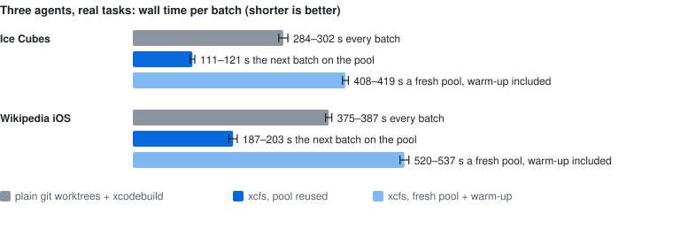

# xcfs

**A file-system layer for agentic iOS development: several AI agents, each in its own git worktree of one Xcode
project, building features in parallel — without a cold build per worktree, without filling the disk, and without
stepping on each other.**

Each agent gets a checkout that is already built (a slot of a pool kept at the baseline), an incremental build session,
a one-file compile check, its own simulator, and a cleanup that removes everything the checkout made and nothing else.
It plugs into Claude Code's worktree and session hooks. Open source (MIT), macOS, Python 3 standard library only.

[Source and README](https://github.com/PatrickSCLin/xcfs) ·
[Using it from an agent](agents.md) · [Benchmarks](benchmark.md) · [Why not just git worktree](why-not-plain-worktrees.md) · [Design](design.md) ·
[Xcode versions](xcode-versions.md) · [What is stable](stability.md)

<picture>
  <source media="(prefers-color-scheme: dark)" srcset="img/agents-wall-time-dark.svg">
  
</picture>

Three agents at once, each with a real task (add a function, fix a compile error, add and run a unit test, build the
app). From the second batch on, the agents wait 46–97 s on Ice Cubes and 130–185 s on Wikipedia iOS, against 284–312 s
and 347–387 s with a new `git worktree` per batch (what agent tools do by default) and 161 s and 185–186 s with
worktrees kept and switched by a script; after main moved, 77 s and 174–189 s against 257–279 s and 217–254 s with kept
worktrees. Nothing is left behind in DerivedData, and each agent tests on its own simulator. MacBook Pro, Apple M1 Max
(10 cores), 64 GB, macOS 27.2, Xcode 27.2. [Method and tables](benchmark.md).

## Start

```
brew install PatrickSCLin/xcfs/xcfs
xcfs init ~/src/app --user                       # detect the project, scheme, platform
xcfs pool warm ~/src/app --slots 3 --background  # build three slots at the baseline
xcfs hook install --apply                        # Claude Code: worktrees come from xcfs
```

Then `claude --worktree <name>` (or a subagent with worktree isolation) starts in a slot that is already built, and the
session's end returns it. Other agent tools call `xcfs checkout`, `xcfs build`, `xcfs check`, `xcfs test` and
`xcfs release` with `--json` ([agents.md](agents.md)). `xcfs uninstall --apply` removes everything xcfs made.
